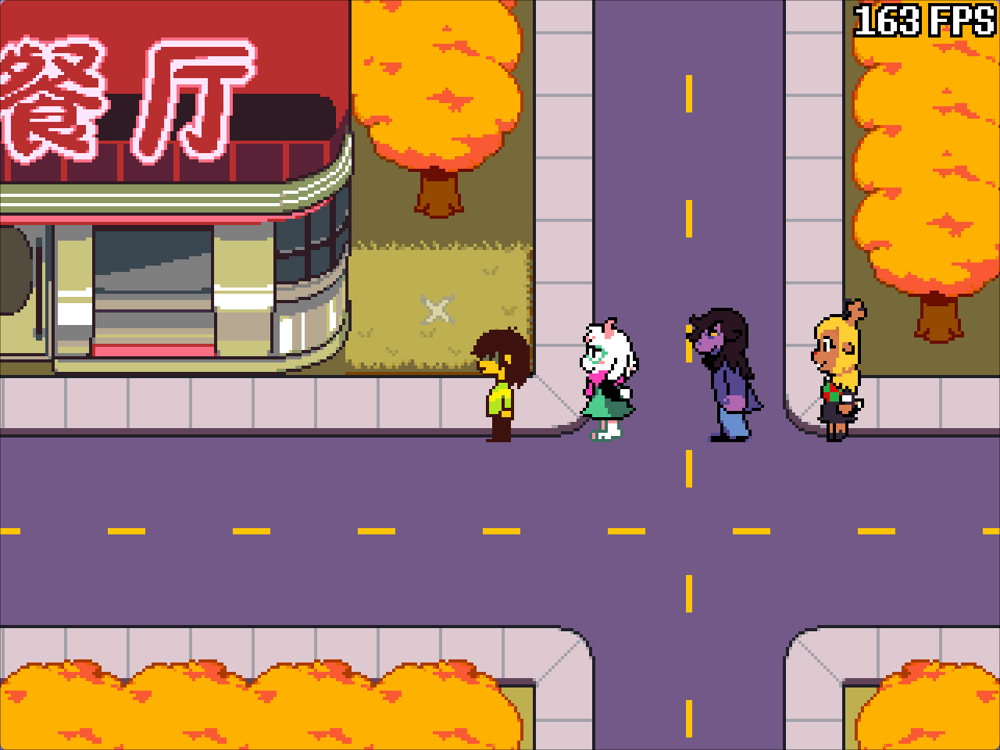
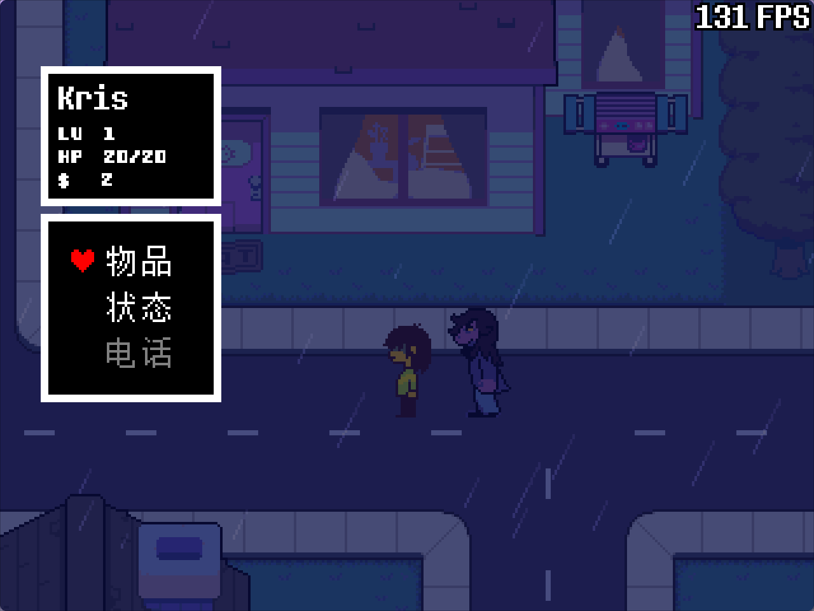
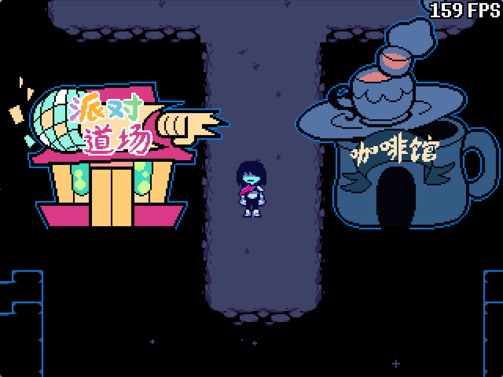
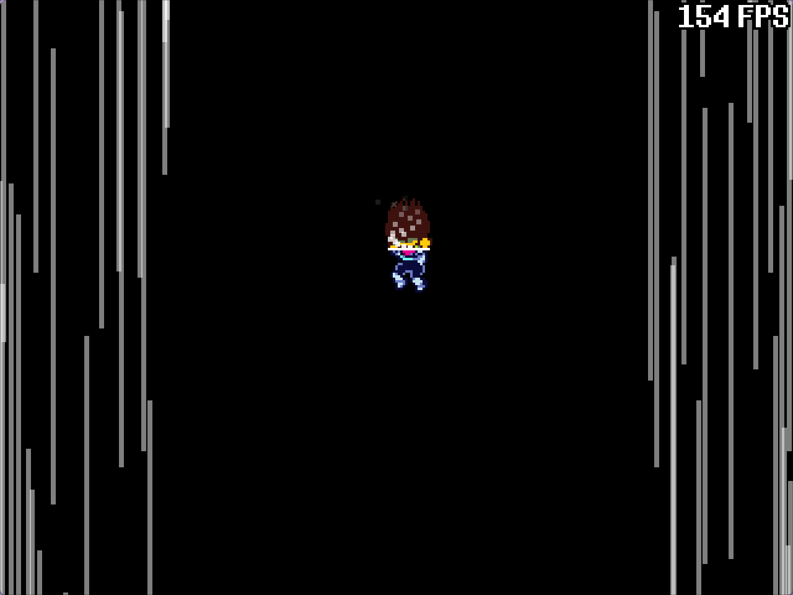
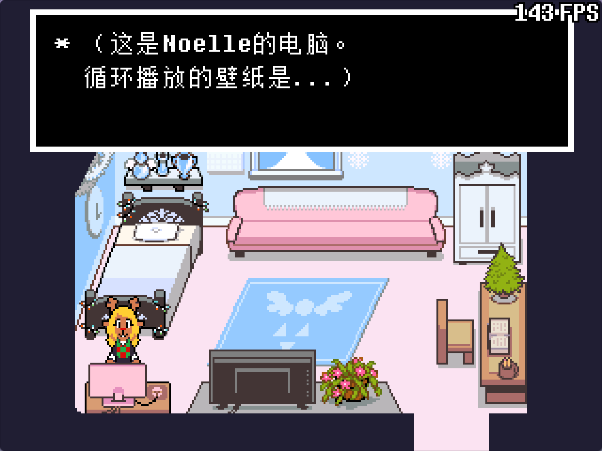

# Hometown Mod (i18n)

[](LICENSE)    <br>
  



<details>
<summary>More screenshots (night walk in the rain / castletown / transformation / Noelle's house)</summary>









</details>

**Hometown Mod (i18n)** — a Simplified Chinese localization fork of the Hometown
(light world) mod, bundling the [kristal-i18n](https://github.com/Bli-AIk/kristal-i18n)
multilingual localization library.

| English | 简体中文                |
| ------- | ----------------------- |
| English | [简体中文](./README.md) |

## Kristal Version Support

| `kristal`                                                                                                                     | `hometown-mod-i18n` |
| ----------------------------------------------------------------------------------------------------------------------------- | ------------------- |
| [v0.11.0-dev](https://github.com/KristalTeam/Kristal/commit/eaf9e0ef4472f2a8090a76fc8b6194230c3e30f7) (`eaf9e0e`, 2026-10-18) | v0.2.1              |
| [v0.11.0-dev](https://github.com/KristalTeam/Kristal/commit/8e592d84065263138d4e92593f0a4ab780d93822) (`8e592d8`, 2026-09-21) | v0.2.0              |
| [v0.11.0-dev](https://github.com/KristalTeam/Kristal/commit/f62afea63ccab02f468c24ac0d096bd8a2c9aa81) (`f62afea`, 2026-08-17) | v0.1.2              |
| [v0.10.0](https://github.com/KristalTeam/Kristal/commit/752bc0688ba97ca8a256ba9125b7e05a1ca6edbd) (`752bc068`, 2026-06-23)    | v0.0.0              |

## What is this

A Simplified Chinese localization fork of the Hometown Mod subtree in AfterChill's
[`sekalisukarumah-boop/deltarune-AC`](https://github.com/sekalisukarumah-boop/deltarune-AC)
(BSD-3-Clause):

- The complete Hometown light world (torielhouse / town / school / hospital / library / convenience store…) plus the dark world castle area (`dark/castletown/...`)
- Bundles **kristal-i18n** (MIT/Apache-2.0, [Bli-AIk/kristal-i18n](https://github.com/Bli-AIk/kristal-i18n)) — a localization library for Kristal, with in-game switching between `en` / `zh_hans`
- Asset usage matches the kristal-i18n README (translation source: [Goodman 3 Localization Group](https://github.com/gm3dr/DeltaruneChinese) gm3dr/DeltaruneChinese workspace)

## Localization coverage

| Content                  | Count   | Notes                                                                                                                     |
| ------------------------ | ------- | ------------------------------------------------------------------------------------------------------------------------- |
| Dialogue/item/UI strings | **550** | `lang/zh_hans.json`, keys are the original runtime text; ≤19 chars per line per Goodman group standard                    |
| Character names          | **24**  | `lang/names.json`, incl. full names (Rudy "Rudolph" Holiday, Asgore Dreemurr, Noelle…), referenced via `[name:xxx]`       |
| Map texture variants     | **20**  | `assets/sprites/lang/zh_hans/`, Chinese signage/building textures (sansstore, hospital, school, Librarby, Ice-E's Pizza…) |
| sans Chinese font        | 1 set   | FangZheng Kaitong Simplified (27/24), used for sans's dialogue only                                                       |

**Mechanics** (kristal-i18n):

- **Source-text lookup**: under `zh_hans`, display paths such as `DialogueText`/`TextChoicebox`/`SpeechBubble` are looked up from original text to translation — dialogue, shop and battle text is translated automatically with zero script changes
- **CJK line-break safety net**: overlong lines are auto-broken at punctuation (fallback for uncovered text)
- **Name references**: `[name:kris]` etc. resolved via names.json; `defaultNameLanguage` can show Chinese or English names independently
- **Texture/font language variants**: `lang/zh_hans/<id>` convention, applied immediately on language switch
- **Language switching**: in-game settings menu or F7 (`Game:setLanguage("zh_hans")`)

## Installation

This project is loaded only by Kristal EL's dedicated loader. Put the whole
directory in a Kristal EL checkout's `mods/` folder (or use its matching Mod ZIP):

```bash
git clone --recurse-submodules git@github.com:Bli-AIk/hometown-mod-i18n.git
cp -r hometown-mod-i18n /path/to/kristal-el/mods/hometown-mod-i18n
```

## Development

Requires Git, LÖVE 11.5, `just`, LuaJIT.

```bash
just run             # run against a local Kristal checkout (supports --encounter / --wave debug args)
just test            # make test: static assertions + luajit syntax check + debug tools dry-run
```

## Setting the hometown map's weather and time

### Time (day/night)

flag `hometown_time`, values `day` / `sunset` / `night` / `sunrise`:

```lua
Game:setFlag("hometown_time", "night")     -- night: night palette + dark overlay + night objects
Game:setFlag("hometown_time", "sunset")    -- sunset
Game:setFlag("hometown_time", "day")       -- day
```

- Controller `scripts/world/controllers/hometowndaynight.lua`: applies `BGPaletteFX`
  palettes based on the flag, the night dark overlay (`HometownNightOverlay`), and
  shows/hides objects per `day_mode`/`night_mode`
- Map object properties `day` / `night` / `sunset` / `sunrise` / `rain` (`true`/`false`):
  the object only appears in the matching time/weather (handled by `Mod:loadObject`)
- Music switches with time of day (`Mod:onMapMusic`: town_day / town / forecasted_hometown_night…)

### Weather (weatherlib)

Depends on the [Bli-AIk/WeatherLib](https://github.com/Bli-AIk/WeatherLib)
maintenance fork as a submodule, pinned to tag `v1.1.1` (based on upstream `v1.1.0`):

```lua
Game.stage:setWeather("rain")      -- rain
Game.stage:hasWeather("rain")      -- check current weather
Game.stage:setWeather()            -- clear (sunny)
```

- Weather types: `rain` / `heavy_rain` / `thunder` / `snow` / `leaf` / `dust` / `fog` / `flipped_rain` / `volcanic` / `hot`
- Systems integrated with weather: `beachwater` (water rises while raining), `leaves`
  border (rain overlay), `Interactable` (`rain_text` rain-only interact text),
  `town_mid` object visibility conditions
- Advanced: `setWeatherParent` / `setWeatherLayer` / `resetWeather` / `WeatherRegistry`

## Upstream sources and references

This mod's content, translations and dependency libraries are not original. Sources and
references are listed below (attribution format follows the
[kristal-i18n](https://github.com/Bli-AIk/kristal-i18n) README):

| Project                                                                                                   | Author/Organization                                                                                        |
| --------------------------------------------------------------------------------------------------------- | ---------------------------------------------------------------------------------------------------------- |
| [deltarune-AC](https://github.com/sekalisukarumah-boop/deltarune-AC) (Hometown Mod subtree, BSD-3-Clause) | [sekalisukarumah-boop](https://github.com/sekalisukarumah-boop)                                            |
| [DeltaruneChinese](https://github.com/gm3dr/DeltaruneChinese) (translation source)                        | [Goodman 3 Localization Group \| UNDERTALE & DELTARUNE Chinese Localization](https://github.com/gm3dr/)    |
| [kristal-i18n](https://github.com/Bli-AIk/kristal-i18n) (bundled localization library, MIT/Apache-2.0)    | [Bli-AIk](https://github.com/Bli-AIk)                                                                      |
| [WeatherLib](https://github.com/Bli-AIk/WeatherLib) (weather maintenance fork, based on upstream v1.1.0)  | [MrFukuo](https://github.com/MrFukuo) (crocokuo); [Bli-AIk](https://github.com/Bli-AIk) (0.11 maintenance) |
| [thrash-machine](https://github.com/Bli-AIk/thrash-machine) (dev toolchain)                               | [Bli-AIk](https://github.com/Bli-AIk)                                                                      |

## License

- Upstream content per `LICENSE` (BSD-3-Clause, Copyright (c) 2021 SylviBlossom)
- kristal-i18n: MIT/Apache-2.0 ([Bli-AIk/kristal-i18n](https://github.com/Bli-AIk/kristal-i18n))
- Attribution and license boundaries for each library: see [`THIRD_PARTY.md`](THIRD_PARTY.md)
- DELTARUNE is copyrighted by Toby Fox; this project is a fan remake and is not affiliated with Toby Fox

### Android release signing and upgrades

Tagged compiled APK releases require four repository secrets:
`ANDROID_SIGNING_KEYSTORE_BASE64`, `ANDROID_SIGNING_STORE_PASSWORD`,
`ANDROID_SIGNING_KEY_ALIAS`, and `ANDROID_SIGNING_KEY_PASSWORD`. Set the public
repository variable `ANDROID_SIGNING_CERT_SHA256` to the signing certificate's
SHA-256 fingerprint. Each project must use its own persistent keystore; never
reuse the template's signing key in a derived project. Missing configuration or
a certificate mismatch stops the Android release before publication.

Release tags must be `vMAJOR.MINOR.PATCH`. The compiled APK uses
`major * 1000000 + minor * 1000 + patch` as its version code, with minor and patch
at most 999 and the result within `1..2100000000`. CI checks the APK's certificate,
package ID, version code, and version name before uploading it. Pull request
builds retain debug signing and do not access release secrets. Wrapper APKs keep
the official LÖVE shell's package identity and version, so they are for local
experiments and tests; tagged releases publish the compiled APK.

Older APK releases used different temporary signing keys. Android cannot install
a newly signed APK over an installation with another certificate. Export saves
before uninstalling that old installation, then install the new APK and restore
them. Future compiled releases signed with the same persistent key can upgrade
in place. Keep an encrypted offline backup of the keystore, alias, passwords, and
certificate fingerprint; losing the key prevents updates to existing installs.
